<div align="center">


# BidGuard

### Live auctions you can trust.

AI agents block fake listings before they go live, every bid is backed by a deposit,<br/>and Solana escrow holds the money until the item arrives.

[](https://bidguard-app.vercel.app)


<br/>

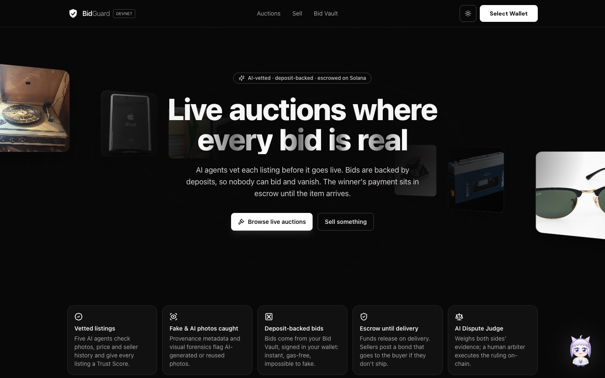

</div>

---

## Contents

- [The problem](#the-problem)
- [The solution](#the-solution)
- [Feature 1: Multi-agent AI vetting](#feature-1-multi-agent-ai-vetting)
- [Feature 2: Secure payments on Solana](#feature-2-secure-payments-on-solana)
- [How a sale works](#how-a-sale-works)
- [Architecture](#architecture)
- [Screenshots](#screenshots)
- [Tech stack](#tech-stack)
- [Getting started](#getting-started)
- [Testing](#testing)
- [Reference](#reference)
- [Security model](#security-model)
- [Limitations](#limitations)
- [Roadmap](#roadmap)
- [Credits and license](#credits-and-license)

---

## The problem

Live and social auctions run on trust, and trust is easy to fake.

| What goes wrong | Who gets hurt |
|---|---|
| Listings use **stock, stolen or AI-generated photos** of items the seller doesn't own | Buyers |
| Bidders **win and vanish**, or sellers **bid up their own items** | Sellers and honest bidders |
| The buyer pays and **nothing ships**, or the item isn't as described | Buyers |

Today the protection is a support ticket filed *after* the money is gone.

## The solution

BidGuard stops fraud **before** it happens, with two layers:

<table>
<tr>
<td width="50%" valign="top">

### 🧠 AI agents vet every listing
An orchestrator runs **four specialist agents in parallel**. In about four seconds they produce a **Trust Score** with plain-English reasons. A fifth agent, the **Dispute Judge**, reviews evidence after a sale.

**AI advises, humans decide.** No agent can move money.

</td>
<td width="50%" valign="top">

### 🔐 Blockchain makes payments provable
Bids come from an on-chain **Bid Vault**, are **signed in the wallet** and are **verified on-chain** at settlement. The winner's payment sits in **escrow**, and the seller posts a **bond**.

Every step is a public Solana transaction.

</td>
</tr>
</table>

---

## Feature 1: Multi-agent AI vetting

When a seller submits a listing, the orchestrator runs the agent crew in parallel and streams each agent's progress to the seller's screen.

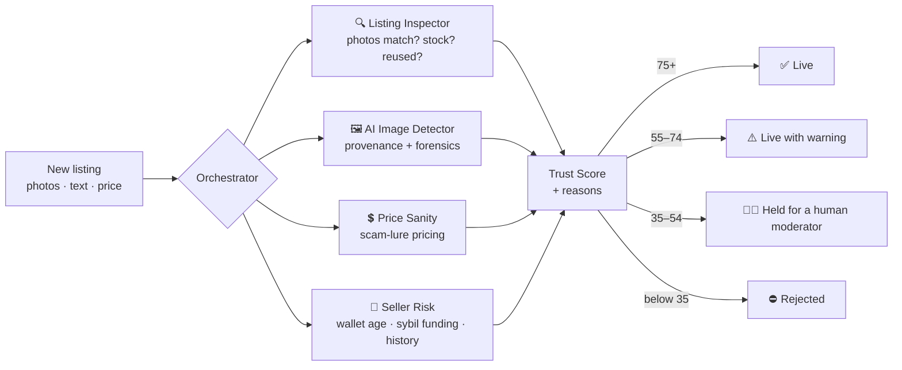

| Agent | What it checks | How |
|---|---|---|
| **Listing Inspector** | Do the photos show the item described? Stock or catalog photos? A photo already used by another seller? | Gemini vision + a 64-bit perceptual hash (dHash) compared against every stored photo |
| **AI Image Detector** | Was the photo made by an image generator? | Scans the **original file** in the browser for C2PA Content Credentials, IPTC `trainedAlgorithmicMedia` and Stable Diffusion/ComfyUI metadata, then runs a visual forensics pass (warped text, melted geometry, impossible lighting) |
| **Price Sanity** | Is the starting price a lure, like a "$40 Stratocaster"? | Gemini estimates the fair resale range |
| **Seller Risk** | Is the seller trustworthy? | On-chain wallet age and activity, who funded the wallet (sybil clusters), lost disputes and failed shipments from the on-chain reputation profile |

**Trust Score** = 100 − 35 × photo mismatch − 25 × price anomaly − 30 × seller risk − 30 × AI-image likelihood − 10 × missing camera metadata.

A listing whose photos look AI-generated is **never approved automatically**: it always goes to a person. Detection is probabilistic, so every score shows its reasons and is presented as a risk signal, not a verdict.

### The Dispute Judge

After a sale, the buyer can open a dispute. Both sides submit **wallet-signed** statements and photos, so nobody can post in someone else's name. The Judge weighs:
- the listing as it was approved;
- the on-chain timeline (paid, shipped, delivered, disputed);
- both sides' evidence, including photos.

It recommends a split with a confidence score and its findings. A **human arbiter** reviews it, can adjust it, and executes the ruling on-chain.

> In testing, a buyer submitted a "damage" photo that was really the listing photo with lines drawn on it. The Judge spotted the edit and ruled for the honest seller.

<p align="center">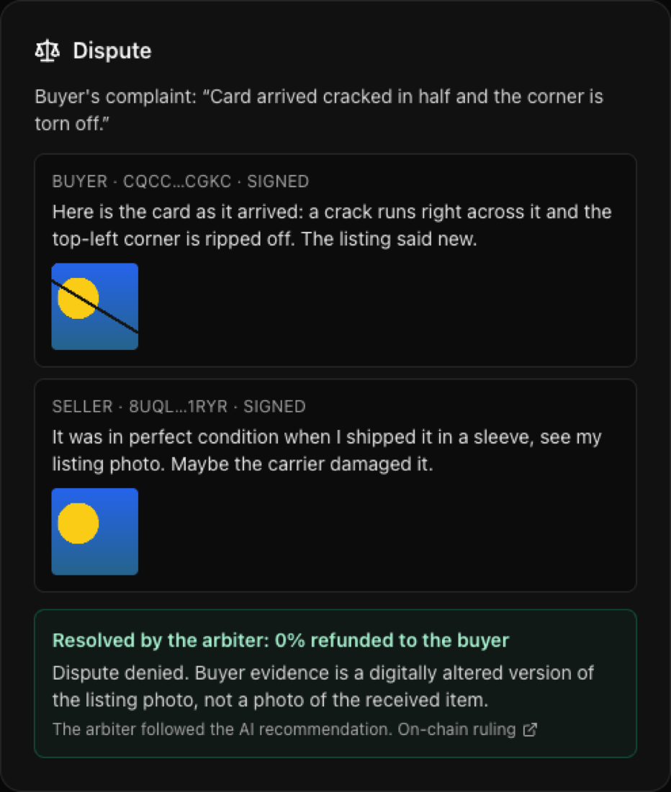</p>

---

## Feature 2: Secure payments on Solana

All money logic lives in an **Anchor program** (`programs/bidguard`), so neither BidGuard nor anyone else can quietly change a bid or skip a payout.

| Step | What happens on-chain | Why it matters |
|---|---|---|
| **1. Deposit** | Bidders deposit USDC into a per-user **Bid Vault** PDA. Withdrawals have a 10-minute cooldown. | You can't bid money you don't have, and you can't pull it out from under a winning bid. |
| **2. Bid** | Bids are **signed messages** in the wallet: instant and gas-free. | Live-auction speed without a transaction per bid. |
| **3. Settle** | The contract checks the winning bid's **Ed25519 signature** through the instructions sysvar, rebuilds the exact signed message, and moves the price from the vault into **escrow**. | Bids can't be forged or altered, not even by the operator. |
| **4. Bond** | Sellers post a refundable bond (5% of the start price, at least 1 USDC) when creating an auction. | Sellers have skin in the game. |
| **5. Release** | Funds release on buyer confirmation, or automatically after the review window. The seller gets the price minus a 2.5% fee, plus the bond back. | The buyer is protected until delivery. |
| **6. Protect** | If the seller doesn't ship within 3 days, the buyer gets a **refund plus the seller's bond**. Disputes split funds on-chain, and the bond goes to the buyer if they win. | Not shipping costs the seller money. |

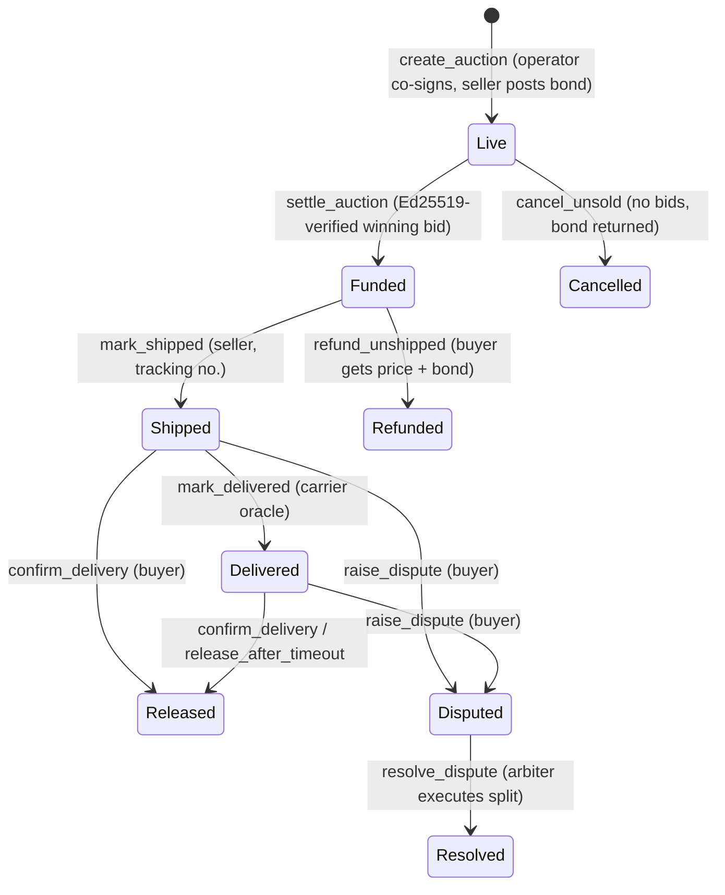

---

## How a sale works

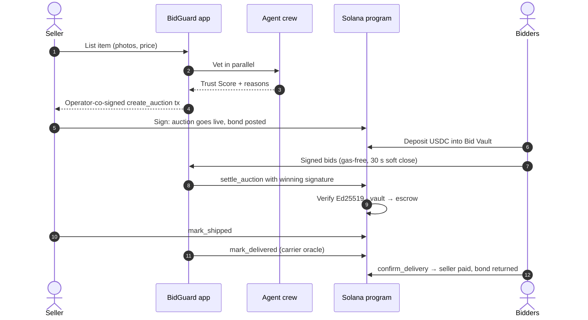

---

## Architecture

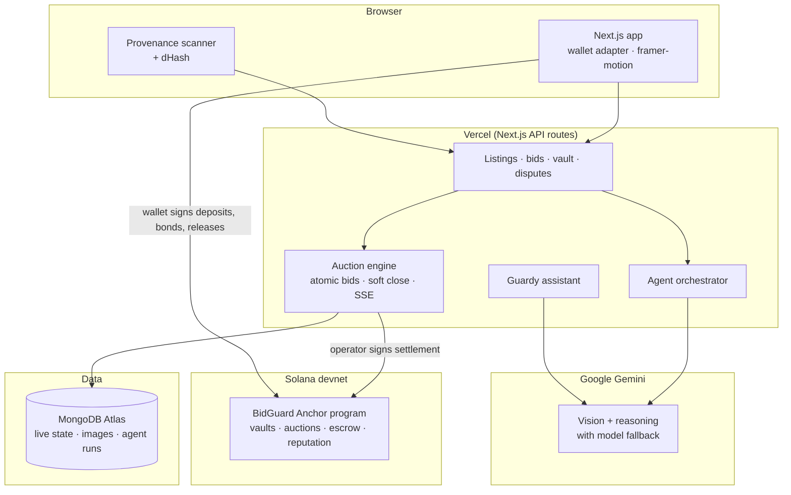

| Layer | Responsibility |
|---|---|
| **Solana program** | The source of truth for money: vaults, auctions, escrow, bonds, disputes and seller reputation. |
| **Auction engine** | The live state: MongoDB conditional updates ensure two bids can never both win. A 30-second soft close and Server-Sent Events push updates to every viewer. |
| **Agent orchestrator** | Runs the agents in parallel. Each returns schema-validated (Zod) JSON, and a rules-only fallback kicks in if the AI is unavailable. |
| **Guardy** | The in-app assistant (anime mascot). It knows the platform rules, the live auctions and the current listing's trust report. It can't move money and never asks for keys. |

---

## Screenshots

<table>
<tr>
<td width="50%">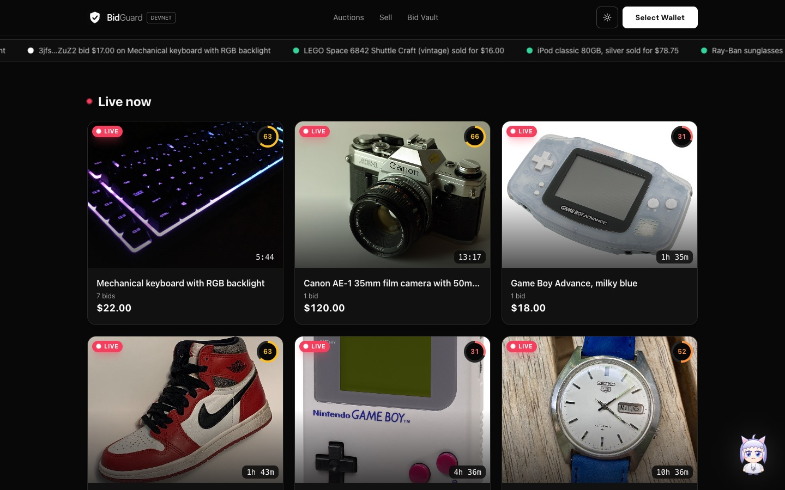<p align="center"><b>Live auctions</b>: Trust Score on every card</p></td>
<td width="50%">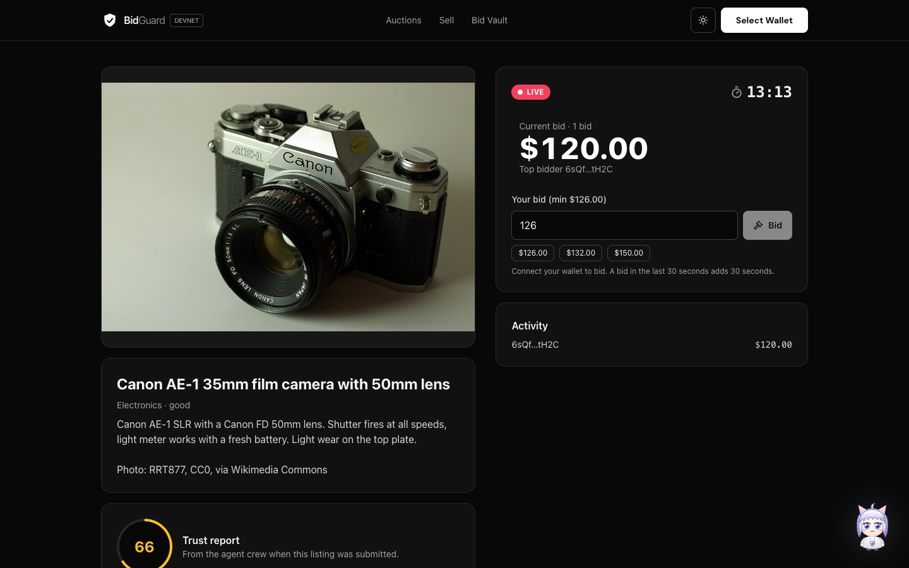<p align="center"><b>Auction room</b>: signed, deposit-backed bidding</p></td>
</tr>
<tr>
<td width="50%">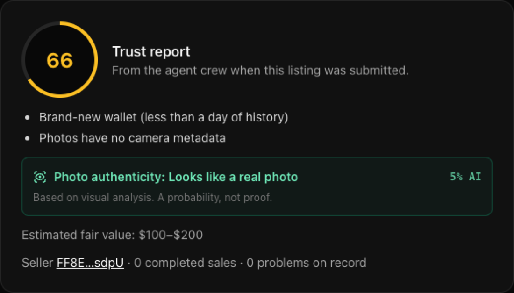<p align="center"><b>Trust report</b>: reasons and photo authenticity</p></td>
<td width="50%">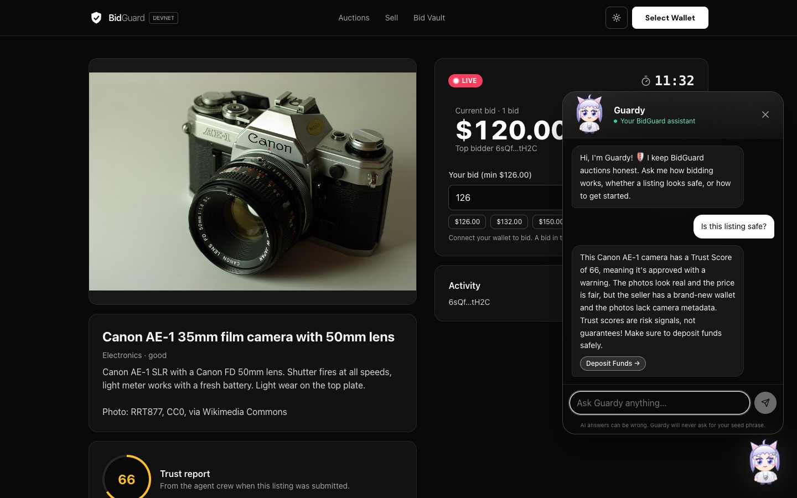<p align="center"><b>Guardy</b>: explains any listing in plain English</p></td>
</tr>
<tr>
<td width="50%">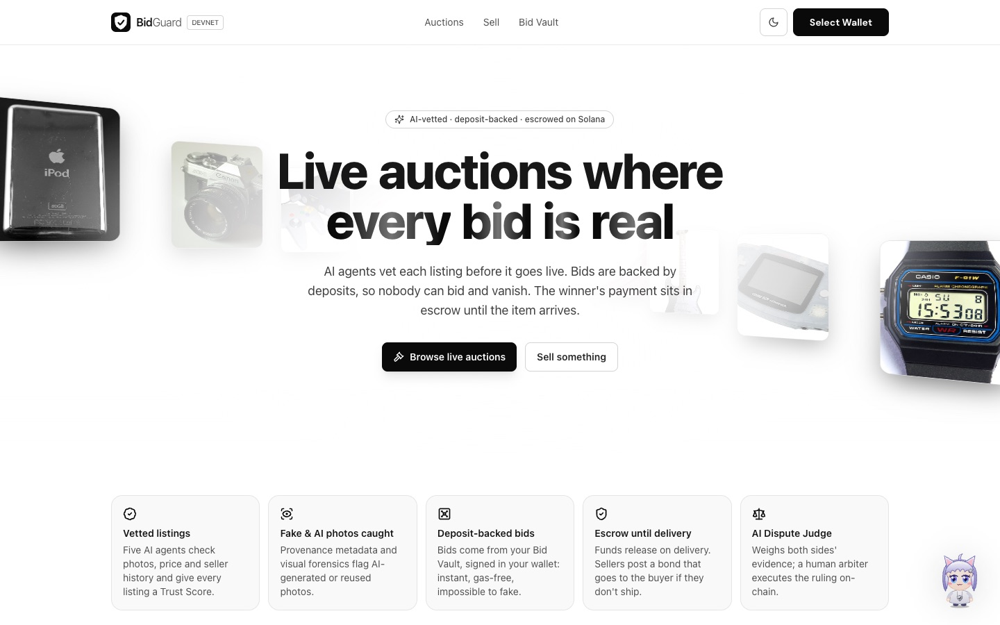<p align="center"><b>Light theme</b>: dark/light toggle, remembered per visitor</p></td>
<td width="50%" align="center">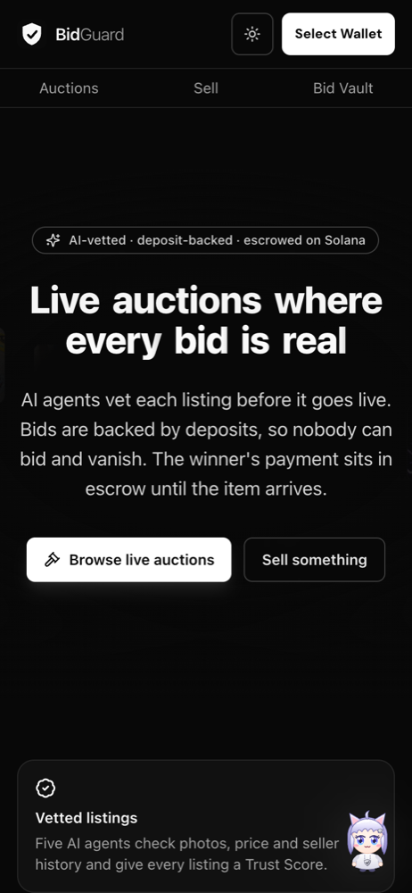<p align="center"><b>Mobile</b>: fully responsive</p></td>
</tr>
</table>

<p align="center">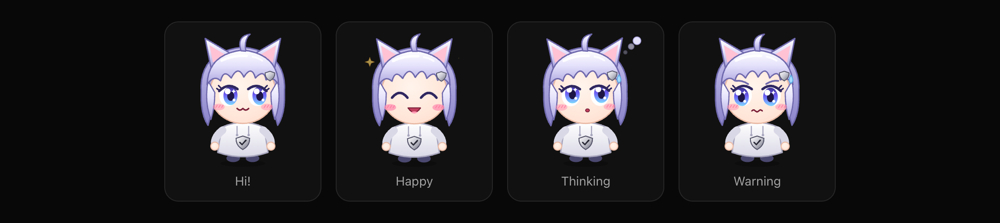<br/><b>Meet Guardy</b>: eyes follow your cursor, and it blinks, waves, thinks and talks.</p>

---

## Tech stack

| Area | Technology |
|---|---|
| Blockchain | Solana (devnet), Anchor 0.31, Rust, SPL Token (test USDC), Ed25519 program, instructions sysvar |
| Wallets | Solana Wallet Adapter (Phantom, Solflare, Backpack and other Wallet Standard wallets), tweetnacl |
| Web app | Next.js 14 (App Router), React 18, TypeScript, Tailwind CSS, framer-motion, lucide-react |
| Backend | Next.js API routes on Vercel (Fluid compute), Server-Sent Events, Zod |
| Data | MongoDB Atlas (live auction state, listings, images, agent runs, rate limits) |
| AI | Google Gemini via its OpenAI-compatible API, with automatic fallback between models |
| Image forensics | C2PA / IPTC / generator-metadata scanner, 64-bit perceptual hash (dHash), exifr |
| Testing | Anchor + Mocha program tests, end-to-end scripts against the deployed app, Puppeteer UI checks |

---

## Getting started

### Try it (no install)

1. Install [Phantom](https://phantom.com/download) and switch it to devnet: **Settings → Developer Settings → Testnet Mode → Solana Devnet**.
2. Get free devnet SOL at [faucet.solana.com](https://faucet.solana.com).
3. Open **[bidguard-app.vercel.app](https://bidguard-app.vercel.app)**, connect your wallet and click **Get test USDC**.
4. **Sell:** go to **Sell → Try a sample item → Submit** and watch the agents work.
5. **Bid:** with a second Phantom account, deposit in **Bid Vault**, then bid. Bid in the last 30 seconds to see the clock extend.
6. **Ask Guardy** (bottom right) anything about the platform or a listing.

> Everything runs on devnet with test USDC. No real money is involved.

### Run it yourself

**Prerequisites:** Node.js 20.18+ (22 recommended), Yarn, Rust, Solana CLI 2.1, Anchor 0.31.1, a MongoDB Atlas cluster and a Gemini API key.

```bash
git clone https://github.com/onkarf1/bidguard.git
cd bidguard
yarn install && (cd app && npm install)

# Build and test the program on a local validator
anchor build
anchor test

# Deploy to devnet (about 4 devnet SOL in ~/.config/solana/id.json)
anchor deploy --provider.cluster devnet
yarn setup        # operator/arbiter keys, test USDC mint, on-chain config → app/.env.local
```

Add the remaining settings to `app/.env.local` (see `app/.env.example`):

| Variable | Purpose |
|---|---|
| `NEXT_PUBLIC_CLUSTER`, `NEXT_PUBLIC_RPC_URL`, `NEXT_PUBLIC_USDC_MINT` | Network settings, written by `yarn setup` |
| `OPERATOR_SECRET_KEY` | Co-signs vetted auctions, settles winning bids, reports delivery, mints test USDC (written by `yarn setup`) |
| `ARBITER_SECRET_KEY` | Executes dispute rulings, receives fees (written by `yarn setup`) |
| `MONGODB_URI` | MongoDB Atlas connection string. On Vercel, Atlas Network Access must allow `0.0.0.0/0`. |
| `GEMINI_API_KEY`, `AI_MODEL` | AI agents (default model `gemini-3-flash-preview`) |
| `AI_FALLBACK_MODELS` | Optional comma-separated fallback models used when the main one is rate-limited |
| `ADMIN_TOKEN` | Moderator and arbiter page (`/admin`). Use a long random string: `openssl rand -hex 24` |

```bash
cd app && npm run dev      # http://localhost:3000
```

**Demo data:** `yarn seed` lists real items (freely licensed photos) through the full pipeline and places opening bids. `MINUTES=3 yarn seed` creates short auctions that end and settle, so "Recently ended" fills up.

---

## Testing

| Command | What it covers |
|---|---|
| `anchor test` | 9 program tests on a local validator: vault cooldown, operator-approved listings with a bond, Ed25519-verified settlement (rejecting early, forged and tampered settlements), the happy path, auto-release, refunds with bond slashing, arbiter-only disputes, agent spending caps, unsold auctions |
| `yarn e2e` | The full HTTP and on-chain flow against a running app: listing → agents → moderator → on-chain auction → deposits → bid rules → soft close → settlement → shipping → carrier → payout, with payouts checked to the cent |
| `FLOW=dispute yarn e2e` | The dispute path: evidence signatures, third-party rejection, the AI Judge, arbiter execution on-chain and exact payouts |
| `APP=https://bidguard-app.vercel.app yarn e2e` | The same suite against the live deployment |

The end-to-end scripts create fresh wallets, fund them from the admin key, and hide their own test auctions from public lists afterwards.

---

## Reference

<details>
<summary><b>On-chain instructions</b> (17)</summary>

| Instruction | Signer | Purpose |
|---|---|---|
| `initialize_config` / `update_config` | admin | Operator, arbiter, treasury, mint, fee, bond and time windows |
| `deposit` | bidder | USDC → Bid Vault |
| `request_withdraw` / `cancel_withdraw` / `withdraw` | bidder | Withdrawal with cooldown |
| `set_agent` | bidder | Authorize a bidding agent key with a spending cap |
| `create_auction` | seller + operator | Open an auction for a vetted listing and post the bond |
| `settle_auction` | operator | Verify the winning bid's Ed25519 signature, move vault → escrow |
| `cancel_unsold` | operator | No valid bids: return the bond |
| `mark_shipped` | seller | Record the tracking number |
| `mark_delivered` | operator | Carrier oracle reports delivery |
| `confirm_delivery` | buyer | Release to the seller |
| `release_after_timeout` | anyone | Release after the review window |
| `refund_unshipped` | buyer | Seller missed the ship window: refund plus bond |
| `raise_dispute` | buyer | Freeze funds for review |
| `resolve_dispute` | arbiter | Execute the split; bond slashed to the buyer if they get 50% or more |

PDA seeds: `config`, `vault`, `vault_tokens`, `auction` (+ seller + id), `escrow`, `seller`.
Program ID (devnet): `6upAUdnE4srVXtYEw1AMhxBxmoZLZ45sJq9dMgRwcp8`

</details>

<details>
<summary><b>API routes</b> (23)</summary>

| Route | Method | Purpose |
|---|---|---|
| `/api/listings` | POST | Create a listing; streams agent progress (NDJSON) |
| `/api/listings/[id]` | GET | Listing status |
| `/api/listings/[id]/tx` | POST | Fresh operator-co-signed `create_auction` transaction for the seller |
| `/api/listings/[id]/activate` | POST | Verify the auction on-chain and open the live room |
| `/api/auctions` | GET | Live and recently ended auctions |
| `/api/auctions/[id]` | GET | Auction room data: state, listing, bids, escrow, reputation |
| `/api/auctions/[id]/bids` | POST | Place a signed bid |
| `/api/auctions/[id]/stream` | GET | Server-Sent Events for the live room |
| `/api/vault/[wallet]` | GET | Bidding power (deposited − pending − committed) |
| `/api/escrow/[id]/carrier` | POST | Carrier oracle (mocked): marks delivered on-chain |
| `/api/disputes/[id]` | GET | Dispute file: on-chain facts, evidence, recommendation, ruling |
| `/api/disputes/[id]/evidence` | POST | Wallet-signed evidence from the buyer or seller |
| `/api/disputes/[id]/judge` | POST | Run the AI Dispute Judge (advisory) |
| `/api/assistant` | POST | Guardy chat |
| `/api/stats`, `/api/activity` | GET | Home page counters and activity ticker |
| `/api/images/[id]` | GET | Stored listing and evidence photos |
| `/api/faucet` | POST | Devnet test USDC |
| `/api/admin/listings`, `/api/admin/listings/[id]` | GET, POST | Moderation queue: approve or reject held listings |
| `/api/admin/disputes`, `/api/admin/disputes/[id]/resolve` | GET, POST | Arbiter queue: execute rulings on-chain |
| `/api/admin/auctions/[id]/hide` | POST | Hide test auctions from public lists |

</details>

<details>
<summary><b>Project structure</b></summary>

```
bidguard/
├── programs/bidguard/src/lib.rs   # Anchor program: vaults, auctions, escrow, disputes, reputation
├── tests/bidguard.ts              # Program tests
├── scripts/
│   ├── setup.ts                   # Keys, test USDC mint, on-chain config
│   ├── seed.ts                    # Demo auctions with real product photos
│   └── e2e.ts                     # End-to-end tests (sale and dispute flows)
├── app/
│   ├── public/samples/            # Freely licensed product photos + CREDITS.md
│   └── src/
│       ├── app/                   # Pages (/, /sell, /auction/[id], /vault, /admin) and API routes
│       ├── components/            # Guardy, ChatBot, AgentTrace, TrustBadge, DisputePanel, …
│       └── lib/
│           ├── agents.ts          # Agent crew + Trust Score
│           ├── disputes.ts        # Dispute Judge
│           ├── auctions.ts        # Auction engine + settlement
│           ├── provenance.ts      # AI-image provenance scanner
│           ├── program.ts         # PDAs and instruction builders
│           └── ai.ts              # Gemini client with model fallback
└── docs/images/                   # README screenshots
```

</details>

---

## Security model

- **Money:** only the program moves funds. Bids are verified with Ed25519 on-chain. Payouts can only go to the buyer, the seller or the fee treasury.
- **Keys:** the operator and arbiter keys stay server-side. Users sign everything else in their own wallet. No secrets are committed.
- **AI is advisory:** agents produce scores and recommendations. A moderator decides on held listings and an arbiter executes disputes.
- **Prompt injection:** listing text and evidence are passed to the models as quoted data, never as instructions. Guardy's links are restricted to in-app pages.
- **Web:** same-origin checks on mutating routes, MongoDB-backed rate limits, wallet-signed dispute evidence, and timing-safe comparison of the admin token.

## Limitations

- Devnet with a test USDC mint. The carrier oracle is mocked: any tracking number reads as delivered.
- AI detection is probabilistic. Provenance metadata proves AI generation when present but can be stripped, and fallback models are weaker than the main model.
- The operator and arbiter are single server keys; in production they would be multisig wallets.
- Demo sellers are all funded from one wallet, so Seller Risk correctly flags them, which lowers their Trust Scores.

## Roadmap

- [ ] Mainnet launch with multisig operator and arbiter keys
- [ ] Real carrier tracking (Shippo / EasyPost)
- [ ] Shill-bid detection and Chat Guard (flags off-platform payment attempts)
- [ ] Concierge bidding agent within a spending cap (on-chain `set_agent` is ready)
- [ ] Solana Blinks: bid from social posts
- [ ] Portable seller reputation as an on-chain credential

---

## Credits and license

- **Product photos:** freely licensed images from [Wikimedia Commons](https://commons.wikimedia.org), credited on each listing and in [`app/public/samples/CREDITS.md`](app/public/samples/CREDITS.md).
- **Code:** released under the [MIT License](LICENSE).

<div align="center">
<br/>

<br/>
<sub>Built with Solana, Anchor, Next.js, MongoDB Atlas and Google Gemini.</sub>
</div>
